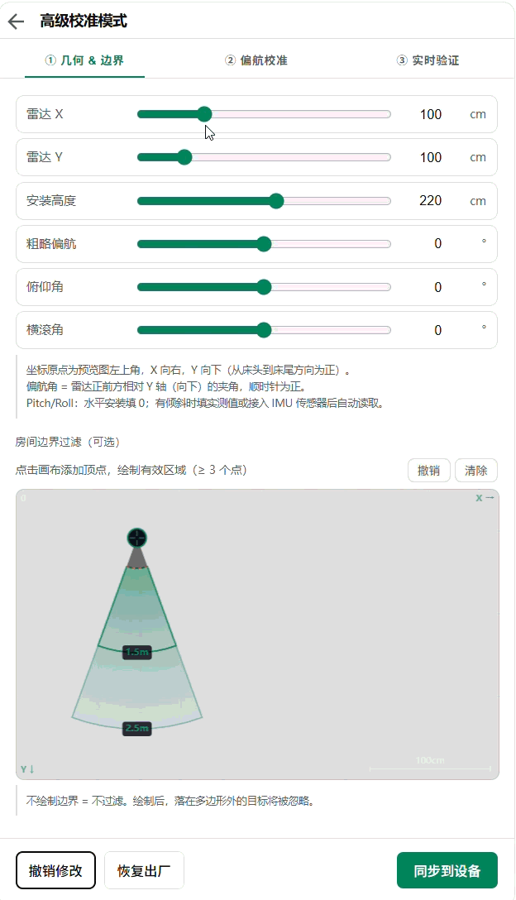

  
  <h1>MMWave Radar HA Card</h1>

[English](./README.md)

这些雷达在 Home Assistant 里的唯一界面。它显示房间俯视图，也是你填写雷达安装位置、朝向和房间边界的地方。固件和融合集成都不自带界面。

## 快速使用

还没烧固件？从 [新手上手指南](https://github.com/zomco/mmwave-component/blob/main/GETTING-STARTED_CN.md) 开始。设备已经在 Home Assistant 里：

1. 用 HACS 按 **Lovelace** 插件安装，然后重启 Home Assistant。

   

2. 编辑面板，**添加卡片**，搜索 **MMWave Radar Card**。选型号后，编辑器列出该型号需要的实体。不用写 YAML。
3. 按顺序校准。这一步决定坐标有没有意义。

| 标签页 | 做什么 | 为什么 |
| --- | --- | --- |
| ① 几何与边界 | 填写雷达位置，画出房间 | 轮廓外的目标不再触发存在检测 |
| ② 偏航 | 在至少三个引导区域停留 | 解算雷达朝向 |
| ③ 实时视图 | 走动，看那个点 | 检查前两步 |

点是镜像的，偏航差 180°。点和你的移动方向成直角，差 90°。回标签页 ② 重做，不要手改数字。1D 雷达隐藏方向校准，用最近/最远距离代替房间多边形。

户型图可选：在编辑器里填图片地址，例如 `/local/floorplans/room.png`（文件放在 `/config/www/floorplans/room.png`），或上传小于 9 MB 的 PNG、JPEG、GIF。`width_cm` 是整张图代表的物理宽度。图片不改变检测过滤。

## 文档地图

| 想了解 | 看 |
| --- | --- |
| 接线、烧录，然后装这张卡片 | [新手上手指南](https://github.com/zomco/mmwave-component/blob/main/GETTING-STARTED_CN.md) |
| YAML、校准、新增型号、从源码构建 | [DIY_CN.md](./DIY_CN.md) |
| 某个型号的卡片配置 | `docs/<型号>/README_CN.md` |
| 轨迹存储、区域事件、录像 | [mmwave-fusion](https://github.com/zomco/mmwave-fusion) — 仅 2D 雷达 |
| 你是 AI 助手 | [AGENTS.md](./AGENTS.md) |

## 雷达型号

分两类。**1D 雷达只上报距离。** 画成一段圆弧而不是一个点，不能使用 [mmwave-fusion](https://github.com/zomco/mmwave-fusion)。卡片仍可显示存在和距离。

**2D 雷达上报地面上的位置。** 可以使用全部功能，包括融合。R60ABD1 同时上报高度，列在这里是因为它可以参与融合。

一台 2D 雷达就够画出房间。多台 2D 雷达可以在浏览器里融合，但不保存。要保存轨迹、区域事件和摄像头录像，需要融合集成。

数字和进度与 [mmwave-component](https://github.com/zomco/mmwave-component/blob/main/README_CN.md) 一致，以那边为准。`—` 表示说明书没有给出。标了「精度」的不是距离门宽度。LD2410 在 0.20 m 分辨率下最远 1.6 m。LD2451 按整米上报。LD2450、LD2454 的距离分辨率在每帧目标里。LD2454 性能表写 8 m，安装章节写跟踪 6 m。

| 状态 | 含义 |
| --- | --- |
| 开发中 | 正在做硬件固件测试。 |
| 测试中 | 正在做 Home Assistant 集成测试。 |
| 已完成 | 集成已验证，运行稳定。 |

### 1D 雷达

| 型号 | 检测距离 | 距离分辨率 | 开发进度 |
| --- | --- | --- | --- |
| LD2410 | 6 m | 0.75 m / 0.20 m | 开发中 |
| LD2410B | 6 m | 0.75 m（协议亦可设 0.20 m） | 测试中 |
| LD2410C | 6 m | 0.75 m（协议亦可设 0.20 m） | 测试中 |
| LD2411 | 2 m（手势 1 m） | — | 开发中 |
| LD2411S | 6 m（微动 3.5 m） | ±5 cm / ±5%（精度） | 开发中 |
| LD2412 | 9 m | 0.75 m | 开发中 |
| LD2420 | 8 m（微动 6 m） | 0.70 m | 开发中 |
| LD2450A | 2 m | 0.2 m（感知精度） | 开发中 |
| LD6002 | 1.5 m（呼吸心率） | — | 开发中 |
| RD-03E | 6 m（微动 3.5 m） | ±5 cm / ±5%（精度） | 开发中 |

### 2D 雷达

| 型号 | 检测距离 | 角度范围 | 距离分辨率 | 开发进度 |
| --- | --- | --- | --- | --- |
| LD2450 | 6 m | 方位 ±60°，俯仰 ±35° | 随帧上报 | 开发中 |
| LD2451 | 100 m | 水平 ±15°，垂直 ±7° | 1 m | 测试中 |
| LD2452 | 6 m | 方位 ±60°，俯仰 ±30° | 0.72 m | 测试中 |
| LD2453 | 6 m | 方位 ±40°，俯仰 ±30° | 0.72 m | 开发中 |
| LD2454 | 8 m | 方位 ±60°，俯仰 ±30° | 随帧上报 | 测试中 |
| R60ABD1 | 2.5 m（呼吸心率 1.5 m） | ±20° | — | 已完成 |

## 相关仓库

| 仓库 | 是什么 | 要装吗 |
| --- | --- | --- |
| [mmwave-component](https://github.com/zomco/mmwave-component) | ESPHome 固件 | 要 |
| **mmwave-card**（本仓库） | Lovelace 卡片 | 要 — 唯一的界面 |
| [mmwave-fusion](https://github.com/zomco/mmwave-fusion) | Home Assistant 集成 | 只有要保存融合结果时才要。仅 2D 雷达。实验性。 |

## 许可证

MIT © zomco
